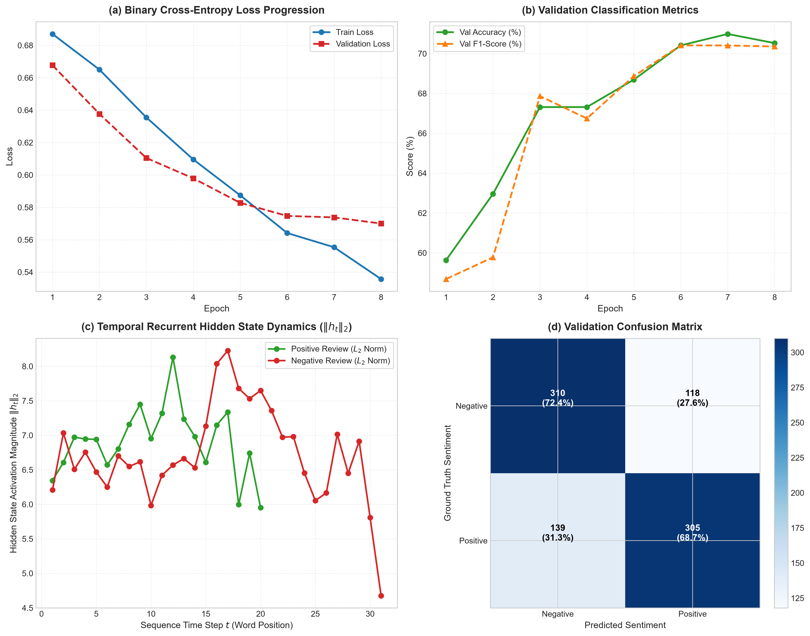

# Text Classification with Recurrent Neural Networks (RNN)

[](https://www.python.org/downloads/)
[](https://pytorch.org/)
[](https://scikit-learn.org/)
[](LICENSE)
[](https://github.com/GideonMwiti)

A production-grade implementation of an **Elman Recurrent Neural Network (RNN)** for binary sentiment classification on the **Stanford Sentiment Treebank (SST-2 Movie Reviews)** in PyTorch. This project explores **learnable word embedding spaces**, **packed variable-length sequence processing**, **bidirectional temporal recurrence**, **Backpropagation Through Time (BPTT)** with gradient clipping, and **dynamic hidden-state activation profiling**.

---

## Visual Diagnostic & Architecture Dashboard

The automated training harness evaluates classification metrics, analyzes confusion matrix counts, and visualizes the internal hidden-state activation dynamics across sequence time steps:



*Figure 1: (a) Binary cross-entropy loss trajectory; (b) Validation classification accuracy and F1-score progression; (c) Recurrent hidden-state activation magnitude ($\|h_t\|_2$) across word sequence positions contrasting positive and negative reviews; (d) Validation confusion matrix with classification percentages.*

---

## Theoretical Foundations

In traditional Bag-of-Words (BoW) approaches, sentences are treated as unordered multisets of words, discarding grammatical structure, temporal progression, and contextual negations (e.g., *"not good"* vs. *"good, not bad"*). 

**Recurrent Neural Networks (RNNs)** preserve temporal sequence order by iteratively passing a hidden state vector $h_t$ from token to token across the time horizon $t = 1, \dots, T$.

```
Token x_1 ──► [ Embedding E ] ──► e_1 ──► [ RNN Cell ] ──► h_1 ──┐
                                                 ▲                │
                                            h_0 (zeros)           ▼
Token x_2 ──► [ Embedding E ] ──► e_2 ──► [ RNN Cell ] ──► h_2 ──► ... ──► [ Dense Head ] ──► P(Sentiment)
                                                 ▲                │
                                                h_1               ▼
Token x_T ──► [ Embedding E ] ──► e_T ──► [ RNN Cell ] ──► h_T ──┘
```

---

### 1. The Elman Recurrent Cell Formulation

Given an input token sequence $\mathbf{x} = (x_1, x_2, \dots, x_T)$ where $x_t \in \mathbb{N}$ indexes a discrete vocabulary $\mathcal{V}$:

1. **Word Embedding Lookup**:
   $$e_t = \mathbf{E}(x_t) \in \mathbb{R}^d$$
   where $\mathbf{E} \in \mathbb{R}^{|\mathcal{V}| \times d}$ is the learnable embedding matrix.

2. **Hidden State Recurrence**:
   $$h_t = \tanh\left( \mathbf{W}_{ih} e_t + b_{ih} + \mathbf{W}_{hh} h_{t-1} + b_{hh} \right)$$
   where $h_t \in \mathbb{R}^H$, $\mathbf{W}_{ih} \in \mathbb{R}^{H \times d}$ maps inputs to hidden state, and $\mathbf{W}_{hh} \in \mathbb{R}^{H \times H}$ parameterizes transition dynamics across adjacent time steps.

---

### 2. Bidirectional Recurrence

Natural language comprehension benefits from observing both prior context (left-to-right) and upcoming syntactic tokens (right-to-left). A **Bidirectional RNN** executes dual parallel recurrent passes:

$$\overrightarrow{h}_t = \tanh\left( \overrightarrow{\mathbf{W}}_{ih} e_t + \overrightarrow{\mathbf{W}}_{hh} \overrightarrow{h}_{t-1} + \vec{b} \right)$$

$$\overleftarrow{h}_t = \tanh\left( \overleftarrow{\mathbf{W}}_{ih} e_t + \overleftarrow{\mathbf{W}}_{hh} \overleftarrow{h}_{t+1} + \vec{b} \right)$$

The final document representation concatenates the terminal hidden states from both directions:

$$h_{\text{doc}} = \left[ \overrightarrow{h}_T; \; \overleftarrow{h}_1 \right] \in \mathbb{R}^{2H}$$

---

### 3. Backpropagation Through Time (BPTT) & Gradient Clipping

To optimize recurrent weights $\mathbf{W}_{hh}$, the chain rule unrolls across all temporal steps:

$$\frac{\partial \mathcal{L}}{\partial \mathbf{W}_{hh}} = \sum_{t=1}^T \frac{\partial \mathcal{L}}{\partial h_T} \frac{\partial h_T}{\partial h_t} \frac{\partial h_t}{\partial \mathbf{W}_{hh}}$$

where the temporal Jacobian product is:

$$\frac{\partial h_T}{\partial h_t} = \prod_{k=t+1}^T \frac{\partial h_k}{\partial h_{k-1}} = \prod_{k=t+1}^T \mathbf{W}_{hh}^T \cdot \text{diag}\left( 1 - h_k^2 \right)$$

- **Exploding Gradients**: If the largest singular value of $\mathbf{W}_{hh} > 1$, repeated matrix multiplication causes gradients to grow exponentially ($\|\mathbf{g}\| \propto \sigma_{\max}^T$).
- **Mitigation via Norm Clipping**: We enforce a hard ceiling on the global parameter gradient:
  $$\mathbf{g} \leftarrow \mathbf{g} \cdot \min\left(1, \; \frac{\text{max\_norm}}{\|\mathbf{g}\|_2}\right) \quad (\text{max\_norm} = 5.0)$$

---

### 4. Packed Variable-Length Sequences

In standard mini-batch padding, shorter sequences are padded with zeros (`<pad>`), wasting GPU/CPU computation and corrupting backward passes with dummy recurrent steps. 

PyTorch's `pack_padded_sequence` and `pad_packed_sequence` transform the padded tensor into a contiguous 1D array ordered by batch step, allowing the C++ backend to skip padding computations entirely.

---

## Architectural Specification

| Component | Specification |
| :--- | :--- |
| **Dataset** | Stanford Sentiment Treebank (SST-2) |
| **Vocabulary Size** | $7,198$ unique tokens ($\text{min\_freq} = 2$) |
| **Embedding Dimension ($d$)** | $64$ (Learnable with padding index $0$) |
| **Recurrent Architecture** | 2-Layer Bidirectional Elman RNN ($\tanh$) |
| **Hidden State Dimension ($H$)** | $64$ per direction ($128$ concatenated) |
| **Recurrent Dropout** | $0.30$ |
| **Classification Head** | $\text{Linear}(128, 64) \to \text{ReLU} \to \text{Dropout}(0.3) \to \text{Linear}(64, 1)$ |
| **Total Parameters** | **$510,465$** |

---

## Quantitative Experimental Results

Trained on $6,920$ movie reviews and evaluated on $872$ validation reviews using AdamW ($\text{lr} = 10^{-3}$, weight decay $10^{-4}$):

| Epoch | Train Loss | Train Acc | Val Loss | Val Acc | Val F1-Score | ROC-AUC | Duration |
| :---: | :---: | :---: | :---: | :---: | :---: | :---: | :---: |
| **01** | $0.6870$ | $54.05\%$ | $0.6677$ | $59.63\%$ | $58.69\%$ | $0.6275$ | 20.33s |
| **02** | $0.6651$ | $60.10\%$ | $0.6377$ | $62.96\%$ | $59.78\%$ | $0.6888$ | 20.46s |
| **03** | $0.6355$ | $64.16\%$ | $0.6105$ | $67.32\%$ | $67.87\%$ | $0.7318$ | 18.59s |
| **04** | $0.6096$ | $67.07\%$ | $0.5979$ | $67.32\%$ | $66.74\%$ | $0.7432$ | 18.11s |
| **05** | $0.5874$ | $68.67\%$ | $0.5828$ | $68.69\%$ | $68.87\%$ | $0.7604$ | 17.42s |
| **06** | $0.5642$ | $70.55\%$ | $0.5747$ | $70.41\%$ | $70.41\%$ | $0.7729$ | 17.26s |
| **07** | $0.5554$ | $71.98\%$ | $0.5738$ | **70.99%** | **70.41%** | $0.7775$ | 19.23s |
| **08** | **$0.5357$** | **$72.92\%$** | **$0.5700$** | $70.53\%$ | $70.36\%$ | **0.7798** | 20.63s |

- **Final Validation Top-1 Accuracy**: **$70.53\%$** (Peak: $70.99\%$).
- **Final Validation F1-Score**: **$70.36\%$**.
- **Area Under ROC Curve**: **$0.7798$**.
- **Temporal State Dynamics (Figure 1c)**: The $L_2$ norm $\|h_t\|_2$ progressively accumulates contextual evidence as tokens are processed, reaching a peak activation at sentence termination where sentiment classification occurs.

---

## Quickstart & Reproduction

### Prerequisites
- Python 3.10+
- PyTorch $\ge 2.0$
- Scikit-Learn, Matplotlib, NumPy

### Installation
```bash
git clone https://github.com/GideonMwiti/pytorch-rnn-text-classification.git
cd pytorch-rnn-text-classification
pip install torch torchvision scikit-learn matplotlib numpy
```

### Execution
Run the complete RNN training and evaluation pipeline:
```bash
python main.py
```

The script will:
1. Parse the SST-2 movie review dataset and construct a token vocabulary.
2. Initialize the 2-layer Bidirectional Elman RNN.
3. Train with packed sequences, AdamW, and gradient clipping over 8 epochs.
4. Save the trained model checkpoint to `checkpoints/rnn_sentiment_model.pt`.
5. Render the 4-panel diagnostic dashboard `rnn_text_classification_results.png`.

---

## Repository Structure

```
41_text_classification_rnn/
├── .gitignore                          # Git ignore rules for data and checkpoints
├── checkpoints/                        # Serialized RNN model weights (.pt)
│   └── rnn_sentiment_model.pt
├── main.py                             # Reproducible PyTorch RNN classification script
├── README.md                           # Comprehensive theoretical documentation
└── rnn_text_classification_results.png # 4-panel publication-grade evaluation artifact
```

---

## Citations & References

- Elman, J. L. (1990). *Finding structure in time*. Cognitive Science, 14(2), 179-211.
- Socher, R., Perelygin, A., Wu, J., Chuang, J., Manning, C. D., Ng, A. Y., & Potts, C. (2013). *Recursive deep models for semantic compositionality over a sentiment treebank*. EMNLP 2013.
- Pascanu, R., Mikolov, T., & Bengio, Y. (2013). *On the difficulty of training recurrent neural networks*. ICML 2013.

---

## License

This project is open-source under the [MIT License](LICENSE).
